# INTERNATIONAL CYBERSECURITY AND DIGITAL FORENSICS ACADEMY

## GRC103: Risk Assessment and Management Techniques

### Week 2 Practical Laboratory:
# Social Engineering and Phishing Campaign Simulation for GRC Professional

**Full Name:** Venesha Adhiambo Ochieng  
**Registration Number:** C11/26/CGRCE/17566  
**Email Address:** c11.cgrce2617566@icdfa.edu.ng  
**Cohort / Batch:** Cohort11  
**Date Submitted:** 2nd November 2026

# Social Engineering & Phishing Campaign Simulation for GRC Professionals

## 1. Introduction

GRC analysts, technical vulnerabilities are only one part of the risk landscape. The human element is often the most exploited attack vector. This lab focuses on **social engineering**, specifically phishing, which is the leading cause of data breaches. You will step into the shoes of both an attacker (to understand the mechanics) and a GRC auditor (to measure risk and policy effectiveness). Your goal is not to trick users, but to objectively measure organizational risk and the effectiveness of security awareness controls.

## 2. Scenario

The CISO is concerned about the organization's resilience to phishing attacks. You have been authorized to conduct a **controlled, internal, and benign phishing campaign** against a test group of users (in this case, a simulated environment). The objective is to gather data on the click-through rate, credential submission rate, and overall user susceptibility to inform future training budgets, policy updates, and risk calculations.

## 3. Lab Setup

- **Your Machine:** Kali Linux (Attacker/Auditor) - IP: 192.168.x.x
  - *We will install a new tool on Kali for this lab.*
- **Target (Simulated User Environment):** We will simulate the target users by sending emails to ourselves or a test mailbox. No actual users will be targeted.
- **Phishing Framework:** **GoPhish** (Open-source phishing toolkit).
- **Target Website:** We will clone the login page of a common internal service (e.g., a fake VPN portal hosted on the Kali machine).

# 4. Step-by-Step Instructions

# Phase 1: Setup and Preparation

## Step 1: Install GoPhish

- **Task:** Download and set up the phishing framework.
- **Create a working directory**
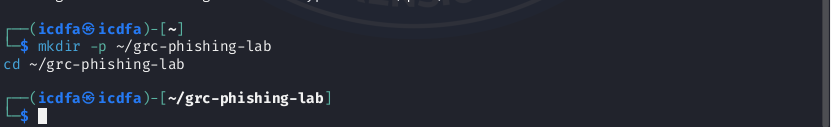

### Commands:

Download the latest version of GoPhish for Linux (check for the latest version on their website)

```bash
wget https://github.com/gophish/gophish/releases/download/v0.12.1/gophish-v0.12.1-linux-64bit.zip
```
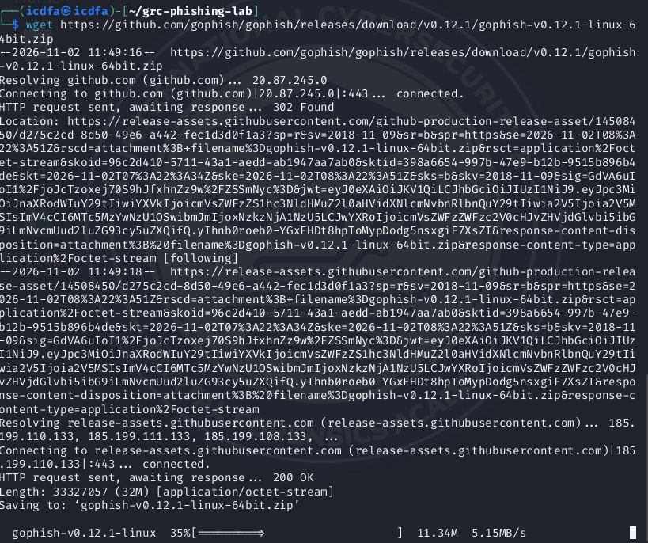

Unzip the file

```bash
unzip gophish-v0.12.1-linux-64bit.zip -d gophish/
```
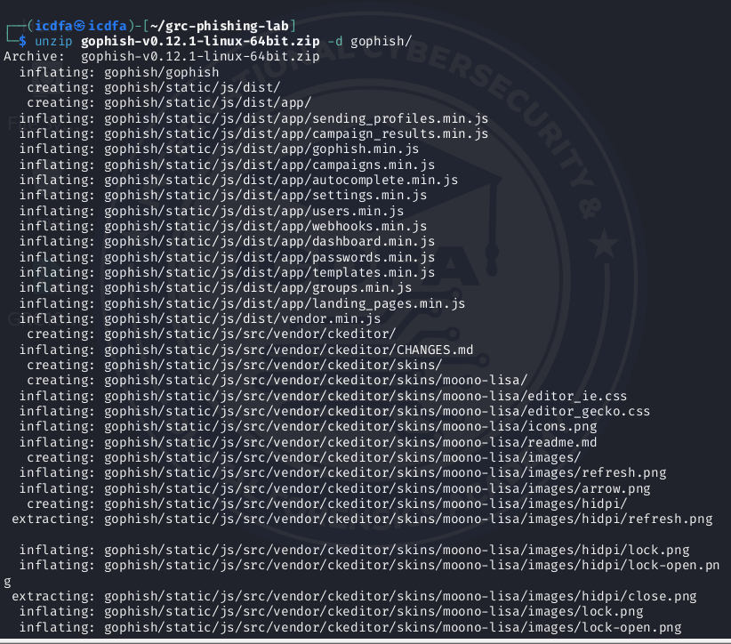

Navigate to the directory

```bash
cd gophish/
```
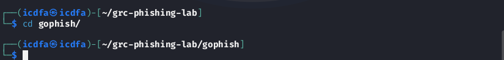

Make the binary executable

```bash
chmod +x gophish
```
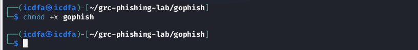

Check configuration server

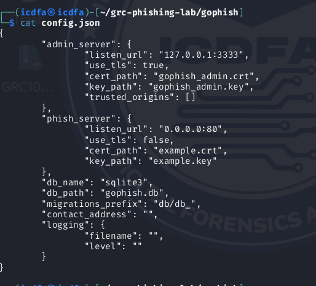

Make changes to phish-server listen url
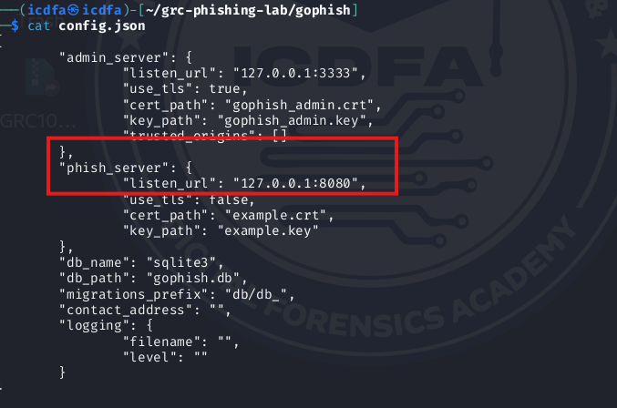

Run GoPhish

```bash
./gophish
```
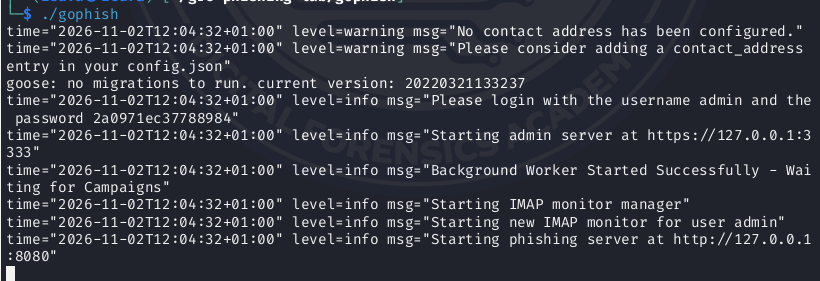

- **Action:** Note the admin interface URL in the terminal (usually `https://127.0.0.1:3333`). Open this in your Firefox browser and accept the SSL warning. Log in with the default credentials (`admin / gophish`).

---
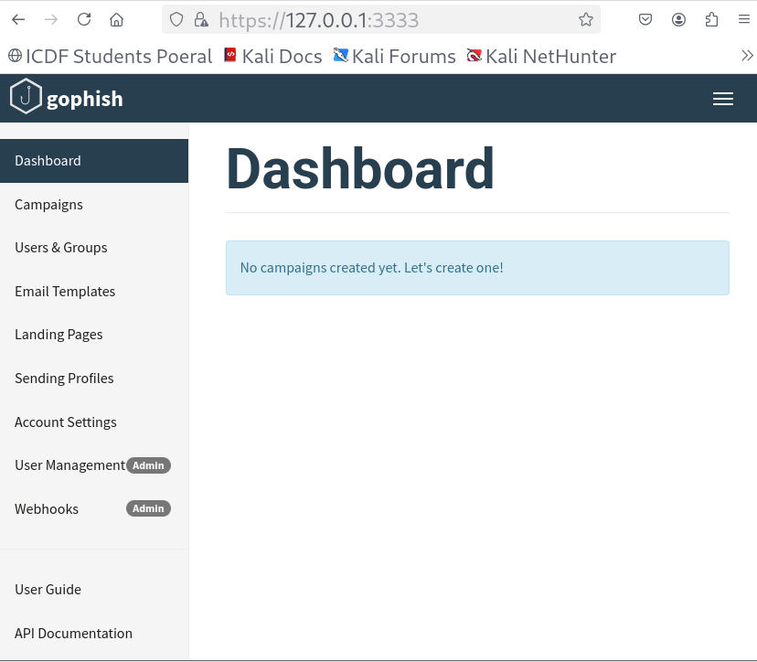

## Step 2: Configure Sending Profile

- **Task:** Tell GoPhish how to send emails. For this lab, we will use a local SMTP server or a test service like **Mailtrap.io** (safer and recommended to avoid being flagged as spam).

- **Action (Using Mailtrap - Free Tier):**

1. Go to https://mailtrap.io/ and create a free account.


3. In your Mailtrap inbox, find the **SMTP settings** under the "Integrations" tab.
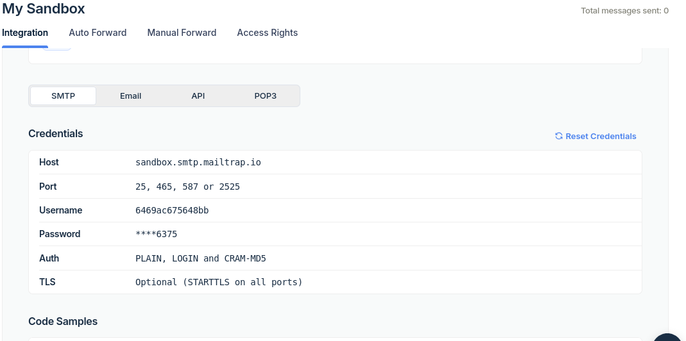

5. In GoPhish, go to **Sending Profiles** > **New Profile**.

6. Name: **Mailtrap Test**

7. From: **Security Team <security-test@yourcompany.com>** (Use a convincing alias).

8. Use the Host, Port, Username, and Password provided by Mailtrap.

9. Click **Save Profile**.

---
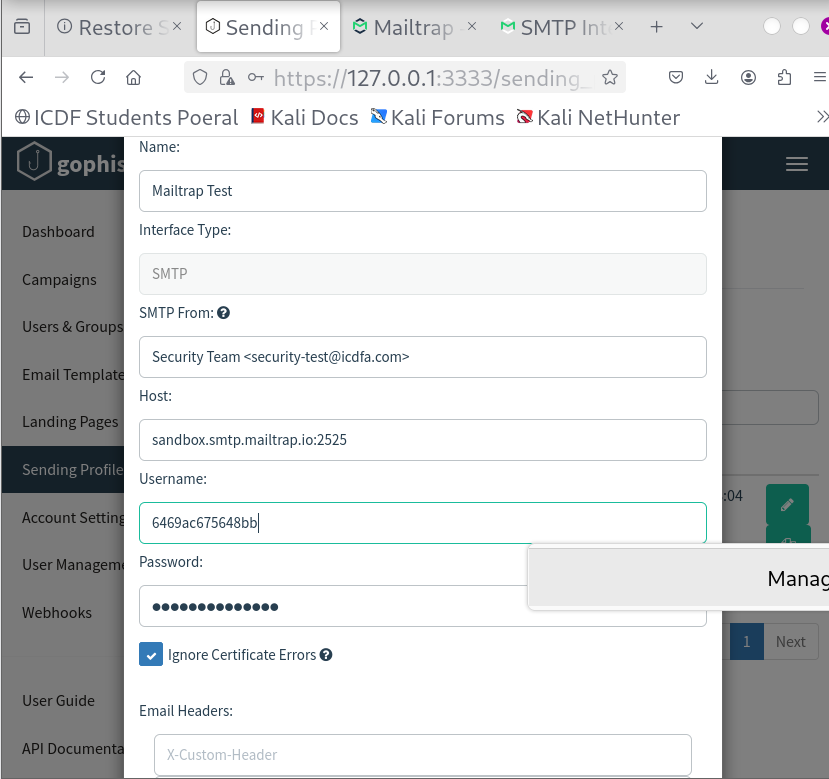

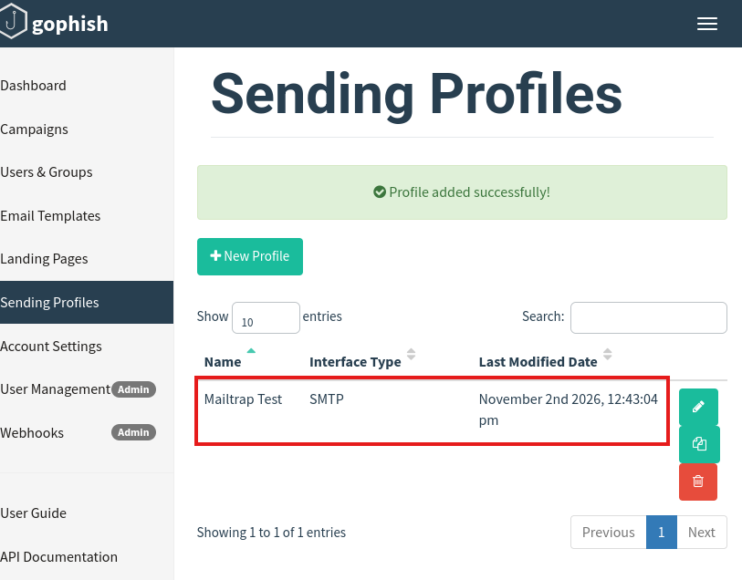

## Step 3: Create a Landing Page

- **Task:** Clone a legitimate login page to use as the phishing destination.

- **Action:**

1. In GoPhish, go to **Landing Pages** > **New Page**.
   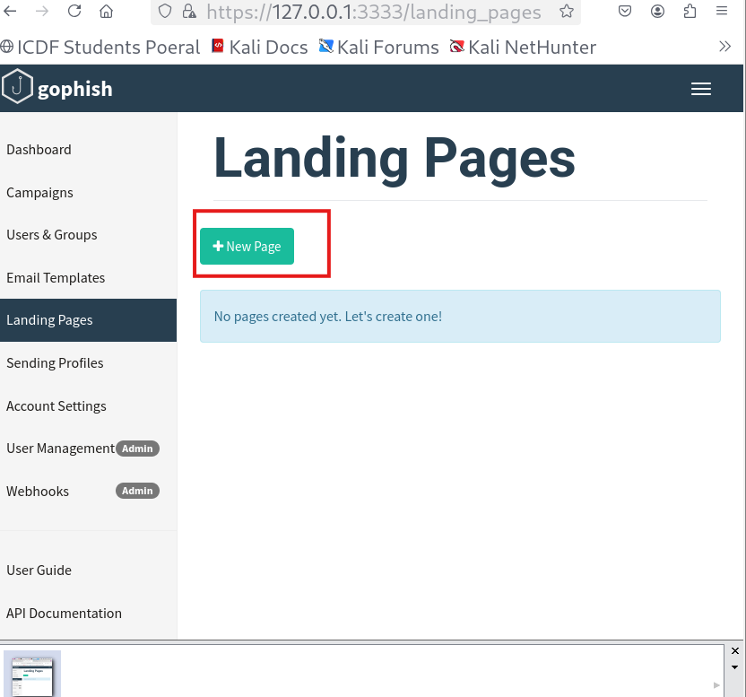

3. Name: **Fake VPN Portal**

4. HTML: Click **Import Site**. Enter the URL of a common login page you want to clone (e.g., your university's VPN portal, a fake internal wiki, or even a Microsoft O365 login). GoPhish will fetch the HTML.

5. **Critical GRC Step:** Check the box **"Capture Submitted Data"** and **"Capture Passwords"**. This is how we will measure success. Also, check **"Redirect to"** and enter a URL like `https://www.yourcompany.com/security-training` to simulate sending users to a training page after they "log in".

---
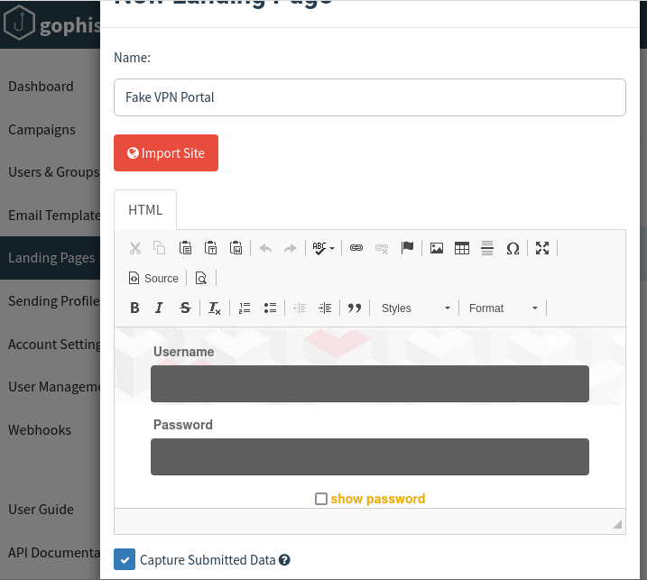

## Step 4: Create an Email Template

- **Task:** Craft a convincing phishing email.

- **Action:**

1. Go to **Email Templates** > **New Template**.
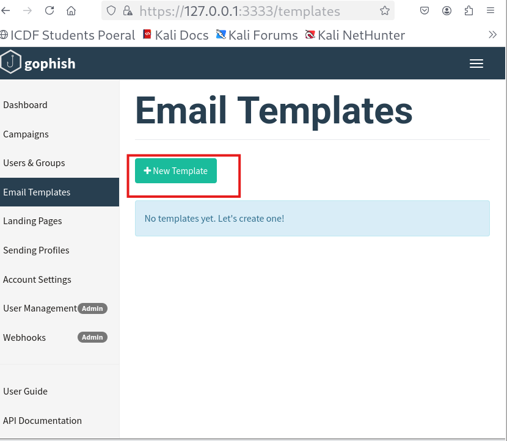
2. Name: **VPN Password Reset Required**

3. Subject: **Action Required: Your VPN Password Expires in 24 Hours**

4. HTML: Click **Import Site** and paste the HTML of a well-crafted professional email. Alternatively, write a simple text:

```html
Dear {{.FirstName}},
<br><br>
Our records indicate that your VPN password must be reset due to a system-wide security update. Failure to do so within 24 hours will result in loss of access.
<br><br>
Please click here to reset your password immediately: {{.URL}}
<br><br>
Thank you,
<br>
IT Security Team
```
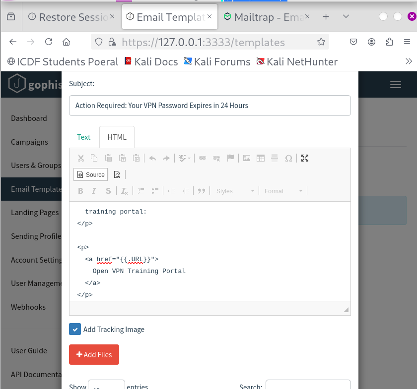

5. Note the use of `{{.FirstName}}` and `{{.URL}}`. These are GoPhish variables for personalization and the phishing link.

---

## Step 5: Define Your Target Group

- **Task:** Create a group of test users. Since this is a lab, we will use ourselves.

- **Action:**

1. Go to **Users & Groups** > **New Group**.
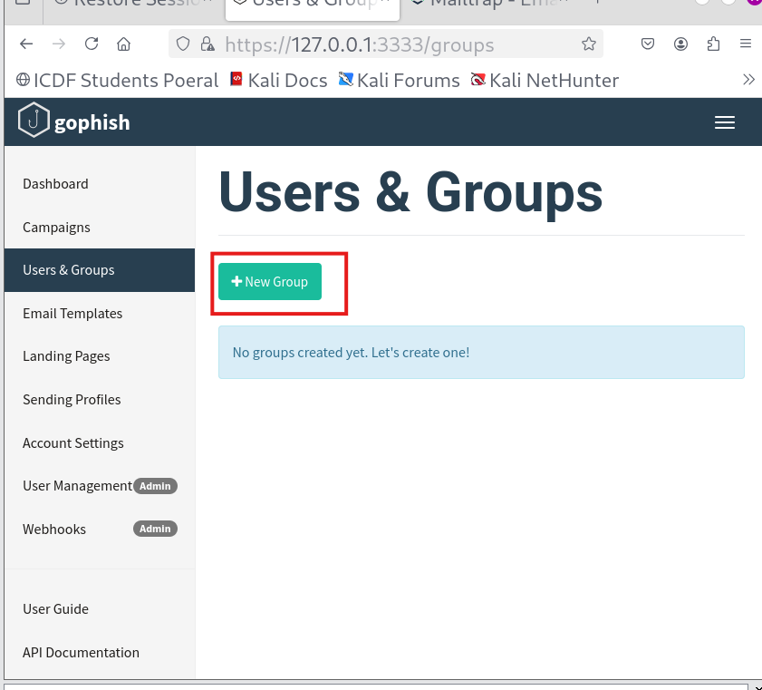
2. Name: **Lab Test Group**

3. Add yourself as a target. Example:

   - Email: `your.test.email@gmail.com` (or a test account)
   - First Name: Lab
   - Last Name: User
   - Position: Employee

> *In a real audit, this would be a CSV import of the test department.*

---
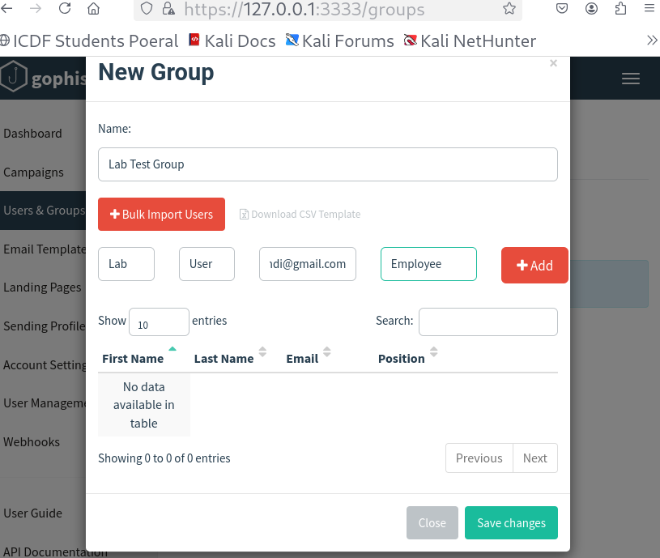

# Phase 2: Launching the Campaign

## Step 6: Launch the Phishing Campaign

- **Task:** Execute the simulated attack and collect data.

- **Action:**

1. Go to **Campaigns** > **New Campaign**.
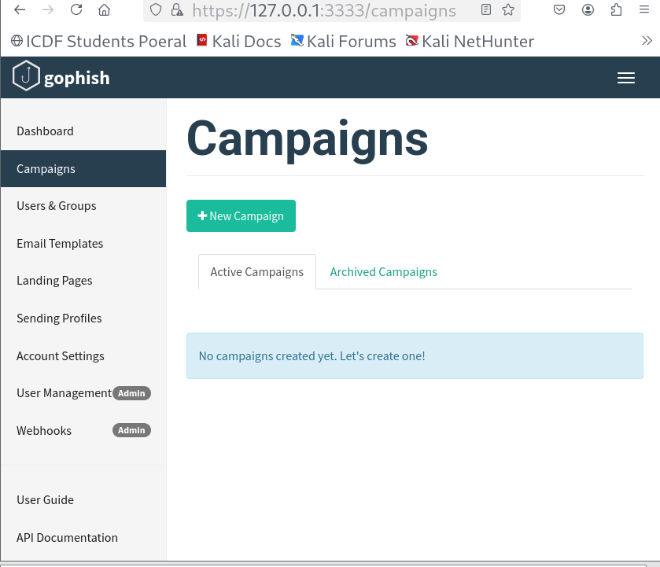
2. Name: **Q3 GRC Phishing Simulation**

3. Select the Email Template, Landing Page, Sending Profile, and Target Group you just created.

4. Set a URL to mask the phishing link (e.g., `https://vpn-yourcompany.com`). GoPhish will handle this.

5. Set the campaign to launch **immediately**.

6. Click **Launch Campaign**.

---
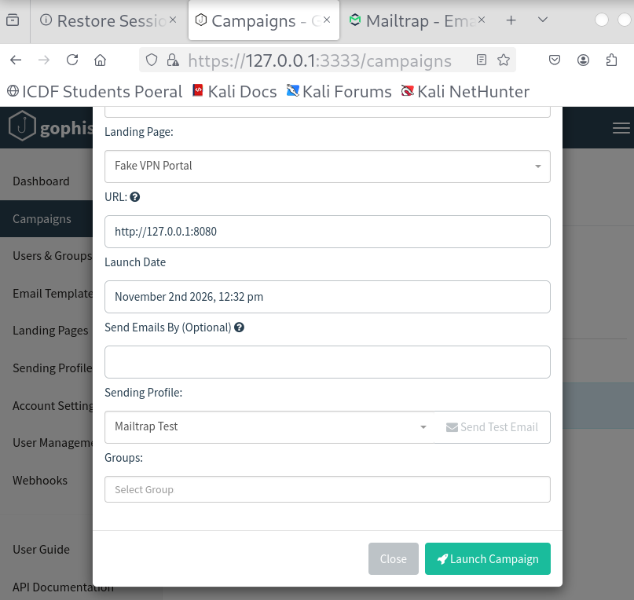

# Phase 3: Monitoring and Analysis (The GRC Core)

## Step 7: Analyze the Results

- **Task:** Review the data collected to calculate key risk metrics.

- **Action:**

1. Go back to the **Dashboard** or **Campaigns** view and click on your running campaign.

2. Monitor the results in real-time:

   - **Email Sent:** Number of emails successfully sent.
   - **Opened:** How many users opened the email (risk metric: curiosity/susceptibility).
   - **Clicked Link:** How many users clicked the link (risk metric: failure to hover and verify).
   - **Data Submitted:** How many users entered their (fake) credentials (critical risk metric).

> **GRC Context:** These metrics directly quantify the human risk component of your organization.

---
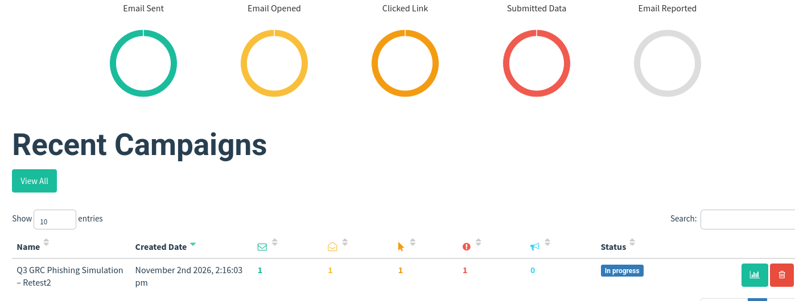

## Step 8: Triage and Risk Assessment

Create a table with your findings and their implications.

Based on your actual GoPhish campaign results, the following risk assessment table has been developed.

| Metric | Result | Calculated Rate | Risk Interpretation | Control Failure / Assessment |
|----------|----------|----------|----------|----------|
| Emails Opened | 1/1 | 100% | The test email was successfully opened, demonstrating interaction with the simulated phishing message. In a real organizational assessment, high engagement could warrant further investigation of phishing awareness. | No confirmed control failure. The email-open tracking mechanism functioned successfully. |
| Links Clicked | 1/1 | 100% | The simulated phishing link was accessed, demonstrating how users could be redirected to potentially malicious websites. In a real attack, this behavior could increase exposure to credential theft and malware. | No confirmed control failure. Link tracking functioned correctly. Link verification practices and awareness controls would require assessment with representative users. |
| Credentials Submitted | 1/1 | 100% | Dummy information was submitted through the simulated landing page. In a real phishing attack, submitting genuine credentials could create a critical risk of unauthorized access and account compromise. | No confirmed control failure. Form submission monitoring functioned correctly. Phishing-resistant MFA and credential protection controls are recommended for mitigating real-world risk. |

---

## Step 9: Drafting the Executive Summary & Recommendations

**To:** CISO, Head of HR, and Executive Management  
**From:** GRC Audit Team  
**Date:** 2 November 2026  
**Subject:** Results of Q3 Controlled Phishing Simulation and Human Risk Assessment

### 1. Executive Summary

A controlled phishing simulation was conducted using GoPhish on Kali Linux, with Mailtrap serving as the email testing environment, to assess phishing-related human risks and evaluate the effectiveness of campaign monitoring mechanisms.

The campaign, **Q3 GRC Phishing Simulation - Retest2**, targeted one authorized test account using a simulated VPN password-reset email. The test successfully recorded email delivery, email opening, link clicking, and dummy-data submission.

The results showed a **100% email open rate, 100% link click-through rate, and 100% simulated data submission rate**. These findings demonstrate that the phishing simulation was successfully executed and that GoPhish accurately recorded the intended interactions.

Although the results illustrate how phishing attacks can influence user behavior, the single-user laboratory environment does not provide sufficient evidence to establish organizational phishing susceptibility or conclude that existing security awareness controls are ineffective.

The exercise highlights the importance of continuous security awareness training, strong authentication controls, and effective phishing detection and reporting procedures.

### 2. Key Findings & Metrics

The GoPhish campaign dashboard recorded the following results:

| Risk Metric | Actual Result | Calculated Rate |
|------------|---------------|-----------------|
| Emails Sent | 1/1 | 100% |
| Emails Opened | 1/1 | 100% |
| Links Clicked | 1/1 | 100% |
| Dummy Data Submitted | 1/1 | 100% |
| Emails Reported | 0/1 | 0% |

#### Email Open Rate - 100%

The test email was successfully opened, demonstrating that the simulated phishing message reached the designated test environment and that the email-tracking mechanism recorded the interaction.

#### Link Click-Through Rate - 100%

The simulated phishing link was accessed successfully. This demonstrates how phishing messages can direct recipients to potentially malicious websites. In a real organizational environment, such behavior could expose users to credential theft or other cybersecurity threats.

#### Simulated Credential Submission Rate - 100%

The test user submitted dummy information through the simulated VPN landing page. This confirms that GoPhish successfully captured the form-submission event.

Although the recorded submission rate was 100%, no genuine credentials were required for the simulation, and the result does not represent an actual credential compromise.

#### Email Reporting Rate - 0%

No phishing report was recorded during the simulation. However, the laboratory did not establish whether a phishing-reporting mechanism was configured and tested. Therefore, this observation cannot independently demonstrate a failure in employee phishing-reporting behavior.

### 3. Risk Analysis

The controlled simulation demonstrated how phishing-related activities can be monitored and analyzed to identify potential human cybersecurity risks.

The successful recording of email openings, link clicks, and simulated data submissions highlights attack behaviors that could expose an organization to security incidents if they occurred in a real environment.

A successful real-world phishing attack could result in:

- **Unauthorized System Access:** Compromised employee credentials could provide attackers with access to corporate applications, internal networks, and sensitive information.
- **Data Breaches and Financial Loss:** Unauthorized access could facilitate confidential data disclosure, fraudulent transactions, operational disruption, and incident response expenses.
- **Reputational Damage:** Security incidents could undermine customer confidence, stakeholder trust, and the organization's reputation.
- **Regulatory and Compliance Exposure:** Compromise of personal information could trigger applicable data protection obligations, breach notification requirements, regulatory investigations, and potential penalties.

The simulation also demonstrates the importance of evaluating the effectiveness of security awareness training, email filtering, authentication controls, and incident reporting procedures.

However, **no organizational control failure was conclusively established** because the campaign was conducted using one authorized test account in a controlled laboratory environment.

A broader, representative phishing assessment would be necessary to measure actual workforce susceptibility and identify systemic control weaknesses.

### 4. Recommended Actions

#### 1. Immediate Technical Control: Strengthen Multi-Factor Authentication (MFA)

Implement phishing-resistant MFA across critical systems, privileged accounts, and remote access services to reduce the likelihood of unauthorized access following credential compromise.

Authentication enhancements should be supported by secure session management, suspicious sign-in monitoring, and appropriate account access controls.

#### 2. Revamp the Security Awareness Training Programme

Transition from reliance on annual compliance videos to continuous, engaging, and role-based security awareness training.

Training should emphasize identifying suspicious emails, verifying URLs, recognizing social engineering tactics, protecting credentials, and reporting suspected phishing attempts.

#### 3. Process Integration: Establish Regular Phishing Simulations

Integrate phishing awareness activities into employee onboarding and conduct authorized quarterly phishing simulations across representative employee groups.

Future campaigns should measure email engagement, click-through rates, simulated credential submission rates, and reporting rates to assess changes in employee behavior and evaluate the effectiveness of security awareness initiatives.

#### 4. Policy Update: Review the Acceptable Use Policy (AUP)

Review and update the organization's Acceptable Use Policy and related information security procedures to explicitly define employee responsibilities for identifying, handling, and reporting suspected phishing attempts.

The policies should also reinforce secure credential management, appropriate use of organizational email systems, and timely security incident reporting.

## 5. Lab Conclusion

The Social Engineering and Phishing Campaign Simulation demonstrated the importance of assessing human-related cybersecurity risks as part of an effective Governance, Risk, and Compliance programme.

The laboratory successfully established a controlled phishing simulation environment using Kali Linux, GoPhish, and Mailtrap. The campaign recorded one successfully sent email, one email opening, one link click, and one dummy-data submission, resulting in recorded rates of 100% across all three interaction metrics.

These results confirmed the successful execution of the simulation and demonstrated how phishing campaign data can be collected, quantified, and interpreted to support cybersecurity risk assessments.

Although the limited test population prevents conclusions about organizational security awareness effectiveness, the exercise highlights the potential consequences of phishing-related behavior and the importance of preventive and detective security controls.
---
